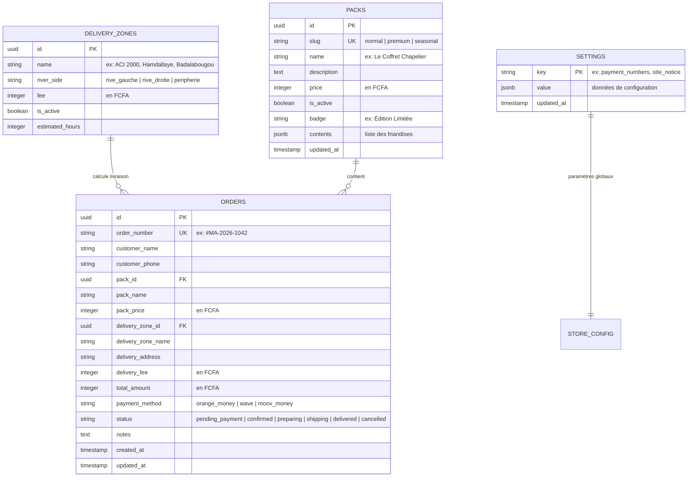

# Conception de la Base de Données — Maison Alice

> **Projet :** Maison Alice (Bamako, Mali)  
> **Phase du cycle de vie :** 07 — database-design  
> **Moteur :** PostgreSQL 15+ (Supabase)  
> **Statut :** READY (Validé)  
> **Date :** 2026-08-19  

---

## 1. Diagramme Entité-Relation (Mermaid ERD)



---

## 2. Dictionnaire des Données & Schéma SQL DDL

### 2.1 Table `packs`
```sql
CREATE TABLE public.packs (
    id UUID PRIMARY KEY DEFAULT gen_random_uuid(),
    slug TEXT UNIQUE NOT NULL,
    name TEXT NOT NULL,
    description TEXT,
    price INTEGER NOT NULL CHECK (price >= 0),
    is_active BOOLEAN DEFAULT true,
    badge TEXT,
    contents JSONB DEFAULT '[]'::jsonb,
    created_at TIMESTAMPTZ DEFAULT now(),
    updated_at TIMESTAMPTZ DEFAULT now()
);
```

### 2.2 Table `delivery_zones`
```sql
CREATE TABLE public.delivery_zones (
    id UUID PRIMARY KEY DEFAULT gen_random_uuid(),
    name TEXT NOT NULL,
    river_side TEXT NOT NULL CHECK (river_side IN ('rive_gauche', 'rive_droite', 'peripherie')),
    fee INTEGER NOT NULL CHECK (fee >= 0),
    is_active BOOLEAN DEFAULT true,
    estimated_hours INTEGER DEFAULT 24
);
```

### 2.3 Table `orders`
```sql
CREATE TABLE public.orders (
    id UUID PRIMARY KEY DEFAULT gen_random_uuid(),
    order_number TEXT UNIQUE NOT NULL,
    customer_name TEXT NOT NULL,
    customer_phone TEXT NOT NULL,
    pack_id UUID REFERENCES public.packs(id),
    pack_name TEXT NOT NULL,
    pack_price INTEGER NOT NULL,
    delivery_zone_id UUID REFERENCES public.delivery_zones(id),
    delivery_zone_name TEXT NOT NULL,
    delivery_address TEXT NOT NULL,
    delivery_fee INTEGER NOT NULL DEFAULT 0,
    total_amount INTEGER NOT NULL,
    payment_method TEXT NOT NULL CHECK (payment_method IN ('orange_money', 'wave', 'moov_money')),
    status TEXT NOT NULL DEFAULT 'pending_payment' 
        CHECK (status IN ('pending_payment', 'confirmed', 'preparing', 'shipping', 'delivered', 'cancelled')),
    notes TEXT,
    created_at TIMESTAMPTZ DEFAULT now(),
    updated_at TIMESTAMPTZ DEFAULT now()
);

-- Index pour recherche rapide et tri dashboard admin
CREATE INDEX idx_orders_created_at ON public.orders (created_at DESC);
CREATE INDEX idx_orders_status ON public.orders (status);
CREATE INDEX idx_orders_customer_phone ON public.orders (customer_phone);
```

### 2.4 Table `settings`
```sql
CREATE TABLE public.settings (
    key TEXT PRIMARY KEY,
    value JSONB NOT NULL,
    updated_at TIMESTAMPTZ DEFAULT now()
);
```

---

## 3. Données Initiales (Seed Data pour Bamako)

```sql
-- Initialisation des Packs
INSERT INTO public.packs (slug, name, description, price, is_active, badge, contents) VALUES
('normal', 'Le Coffret Alice', 'Sélection féerique de bonbons fins, biscuits sablés pur beurre et dragées au chocolat noir stabilisé.', 15000, true, 'Classique', '["Sablés artisanaux", "Dragées chocolat noir 70%", "Bonbons gélifiés fruités", "Clé dorée souvenir"]'),
('premium', 'Le Coffret Royal du Chapelier', 'Expérience de dégustation d''exception avec assortiment de douceurs raffinées, nougat royal, calissons et carte personnalisée.', 25000, true, 'Best Seller Luxe', '["Assortiment prestige", "Nougat de Montélimar & Miel", "Calissons fins", "Chocolats pralinés haute tenue", "Montre gousset décorative", "Ruban satin & Carte manuscrite"]'),
('seasonal', 'Le Coffret Éphémère de la Reine', 'Édition saisonnière limitée aux couleurs et saveurs de l''événement festif en cours.', 20000, true, 'Édition Limitée', '["Friandises spéciales", "Pâtes de fruits rouges", "Dragées rubis", "Parchemin royal exclusif"]');

-- Initialisation des Zones de Livraison à Bamako
INSERT INTO public.delivery_zones (name, river_side, fee, is_active) VALUES
('ACI 2000 / Hamdallaye', 'rive_gauche', 1500, true),
('Badalabougou / Quartier du Fleuve', 'rive_droite', 1500, true),
('Hippodrome / Quinzambougou / Korofina', 'rive_gauche', 2000, true),
('Bacodjicoroni / Golf / Kalaban Coura', 'rive_droite', 2000, true),
('Yirimadio / Niamana / Missabougou', 'rive_droite', 2500, true),
('Sebenikoro / Djicoroni Para', 'rive_gauche', 2500, true),
('Sotuba / Moribabougou (Périphérie)', 'peripherie', 3500, true);

-- Initialisation des Paramètres Boutique & Numéros Marchands
INSERT INTO public.settings (key, value) VALUES
('payment_info', '{
    "orange_money": { "number": "+223 XX XX XX XX", "name": "Maison Alice" },
    "wave": { "number": "+223 XX XX XX XX", "name": "Maison Alice" },
    "moov_money": { "number": "+223 XX XX XX XX", "name": "Maison Alice" }
}'::jsonb);
```

---

## 4. Politiques de Sécurité Row Level Security (RLS)

```sql
-- Activer RLS sur toutes les tables
ALTER TABLE public.orders ENABLE ROW LEVEL SECURITY;
ALTER TABLE public.packs ENABLE ROW LEVEL SECURITY;
ALTER TABLE public.delivery_zones ENABLE ROW LEVEL SECURITY;
ALTER TABLE public.settings ENABLE ROW LEVEL SECURITY;

-- 1. Tables publiques en lecture (Packs, Zones, Settings)
CREATE POLICY "Public Read Packs" ON public.packs FOR SELECT USING (true);
CREATE POLICY "Public Read Delivery Zones" ON public.delivery_zones FOR SELECT USING (true);
CREATE POLICY "Public Read Settings" ON public.settings FOR SELECT USING (true);

-- 2. Création de commande publique (INSERT anonyme)
CREATE POLICY "Public Insert Orders" ON public.orders FOR INSERT WITH CHECK (true);

-- 3. Accès complet réservé à l'administrateur authentifié
CREATE POLICY "Admin Full Access Orders" ON public.orders FOR ALL TO authenticated USING (true);
CREATE POLICY "Admin Full Access Packs" ON public.packs FOR ALL TO authenticated USING (true);
CREATE POLICY "Admin Full Access Delivery Zones" ON public.delivery_zones FOR ALL TO authenticated USING (true);
CREATE POLICY "Admin Full Access Settings" ON public.settings FOR ALL TO authenticated USING (true);
```

---

## 5. Statut du Gate

* **Statut Database Design** : **READY**
* **Prochaine étape** : Phase 08 — api-design (Contrats d'interface & services).
